# 机房资产盘点系统使用文档

文档版本：V1.0  
编写日期：2026-07-29  
适用对象：传输网管维护管理员、片区现场盘点人员、系统运维人员

## 1. 系统概述

本系统用于机房资产清单导入、片区任务领取、现场扫码盘点、资产盘点数据导出、AI 模型分析和整改闭环管理。当前系统由四部分组成：

| 组成 | 技术/入口 | 主要作用 |
|---|---|---|
| PC 后台 | Vue3 + Element Plus，默认 `http://127.0.0.1:5173` | 管理员导入清单、查看进度、导出数据、AI 分析、账号管理 |
| 后端服务 | FastAPI，默认 `http://127.0.0.1:8000` | 提供 PC 和小程序接口，管理数据库、文件、鉴权 |
| 微信小程序 | 微信开发者工具或体验版 | 现场人员登录、领取任务、扫码盘点、提交整改闭环 |
| 本地 Agent | Python 服务，默认 `http://127.0.0.1:9000` | 接收脱敏盘点数据，执行本地规则并调用 DeepSeek 模型 |

## 2. 角色与权限

| 角色 | 使用入口 | 权限范围 |
|---|---|---|
| 管理员 | PC 后台 | 导入任务清单、查看全量进度、导出资产盘点数据、配置/检测 AI、审核并下发整改任务、维护账号 |
| 现场人员 | 微信小程序 | 只能查看和领取本人片区任务，执行现场扫码盘点，处理被下发的整改任务 |
| 本地 Agent | 后端调用 | 只读脱敏数据，输出分析结论和整改建议，不直接写库或越权读取文件 |

片区固定为四类：`汇聚及核心`、`南区`、`北区`、`西区`。现场人员不允许跨片区领取任务。

## 3. 启动与登录

### 3.1 日常启动

只使用 PC 后台和小程序时：

```text
1. scripts/windows/start_backend.bat
2. scripts/windows/start_admin_vue.bat
```

需要使用 AI 模型分析时：

```text
1. scripts/windows/start_local_agent.bat
2. scripts/windows/start_backend.bat
3. scripts/windows/start_admin_vue.bat
```

微信开发者工具调试小程序时：

```text
1. scripts/windows/switch_miniprogram_mode.bat 选择 dev
2. scripts/windows/start_backend.bat
3. 微信开发者工具重新编译小程序
```

### 3.2 PC 登录

打开 PC 后台地址后，输入管理员账号密码登录。

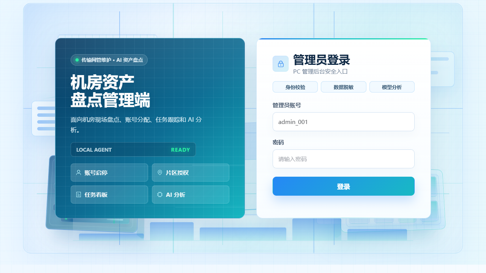

登录成功后进入后台左侧导航，可切换各业务模块。退出登录按钮位于左侧栏当前账号区域。

## 4. PC 后台功能

### 4.1 任务管理：清单导入

后台左侧进入“任务管理”，默认打开“清单导入”页签。

用途：管理员导入 Excel 资产清单，系统按机房生成待领取盘点任务。

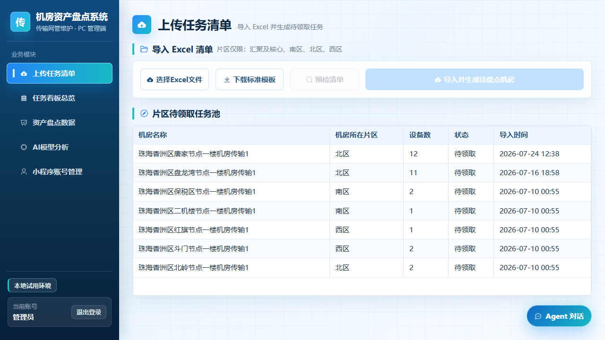

主要功能：

| 功能 | 说明 |
|---|---|
| 下载标准模板 | 下载系统要求的 Excel 模板 |
| 选择 Excel 文件 | 选择待导入的资产清单 |
| 预检清单 | 导入前检查片区、机房、设备数量、条码缺失等问题 |
| 导入并生成盘点机房 | 预检通过或确认异常后生成待领取任务 |
| 片区待领取任务池 | 展示已导入、尚未被现场人员领取的机房任务 |

使用注意：

- Excel 必须包含 9 列：`机房名称`、`机房所在片区`、`设备类别`、`网元名称`、`设备型号`、`资产标签号`、`设备机架`、`生命周期状态`、`地点编码`。下载模板后请删除示例行。
- 除上述 9 列外，可以增加其他业务列；系统保留可识别的扩展字段。地点编码按文本填写，保留前导零。
- Excel 片区必须属于 `汇聚及核心`、`南区`、`北区`、`西区`。
- 建议先预检，再导入，避免错误清单生成大量无效任务。
- 导入后现场人员只能在小程序领取本片区任务。

### 4.2 任务管理：任务看板

在“任务管理”中切换至“任务看板”页签，查看导入后的最新任务和盘点进度。页签之间切换会保留已选文件和查询内容。

用途：查看盘点任务整体进度、片区完成情况和任务状态。

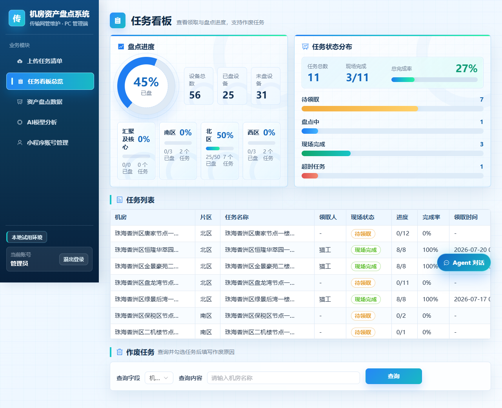

主要功能：

| 功能 | 说明 |
|---|---|
| 盘点进度 | 展示设备总数、已盘设备、未盘设备和整体完成率 |
| 片区完成情况 | 分别展示四个片区的完成率、已盘数量和任务数 |
| 任务状态分布 | 展示待领取、盘点中、现场完成、超时任务数量 |
| 任务列表 | 查看机房、片区、任务名称、领取人、现场状态、进度、完成率、领取时间 |
| 作废任务 | 查询任务后填写原因，将错误或无效任务作废 |

适用场景：

- 每日查看各片区盘点推进情况。
- 快速定位未领取、超时或长期未完成的机房。
- 导入错误清单后，按机房或任务查询并作废。

### 4.3 资产盘点数据

用途：呈现当前综资基线和现场盘点数据，支持管理员修正资料、查询和 Excel 下载。

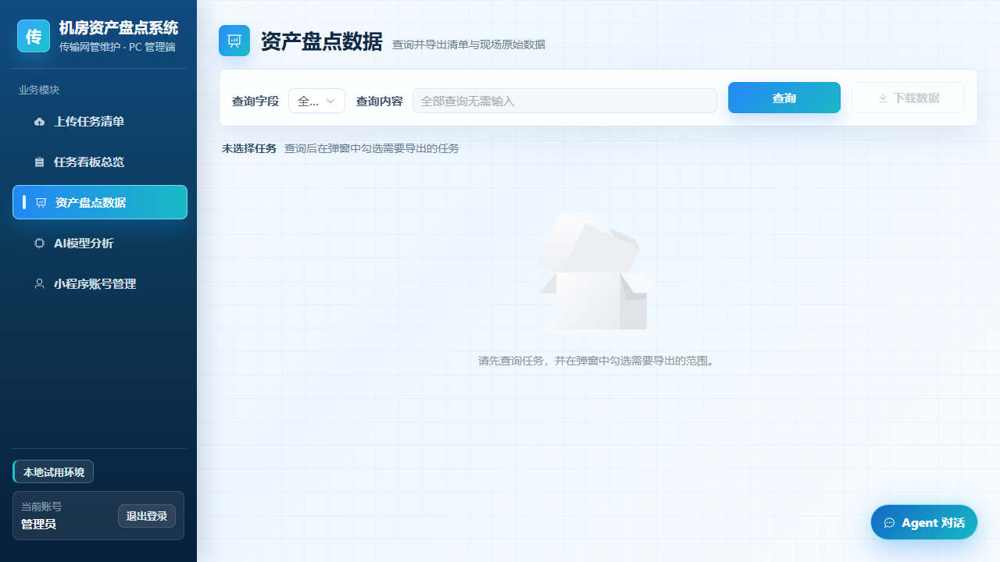

主要功能：

| 功能 | 说明 |
|---|---|
| 查询任务 | 支持按全部、机房、任务、片区、领取人、现场状态查询 |
| 查询结果弹窗 | 查询后在弹窗中勾选需要导出的任务 |
| 统计汇总 | 展示选中任务的设备总数、已盘、未盘、进度 |
| 表格展示 | 设备、传输综合柜及 ODF/IODF 机架表不显示来源列；名称和型号最多显示两行，悬停可查看完整内容 |
| 修改综资 | 已完成机房可按设备修改综资型号、资产条码和设备机柜位；保存后用于本任务后续三方比对及导出，无需重新派发盘点任务 |
| 转整改 | 整个任务经现场确认完成后，管理员填写问题类型、确认依据和整改要求，加入待审核整改台账；资料需满足三方比对要求，同组已有未闭环单时不可重复建单 |
| 下载资产盘点数据 | 将最新综资基线和现场盘点数据合并导出，方便管理员查看当前有效数据 |

“修改综资”更新的是本系统的综资基线，现场盘点结果保留，外部综资原系统仍需另外维护。修改型号后，三方比对中对应的型号需重新人工判断。整机房基线已更新时，单台修改会保留其余设备；若别人已更新基线，需重新打开修改窗口读取最新数据。

边界说明：

- 本模块不再输出资产差异、异常复核、整改建议等分析字段。
- 已盘、未盘、进度是保留字段，用于基础进度查看。
- 深度问题判断由 AI 模型分析模块处理。

### 4.4 AI 模型分析

用途：通过本地 Agent 对已完成或指定范围的盘点数据进行脱敏分析，生成清单式问题和整改建议。

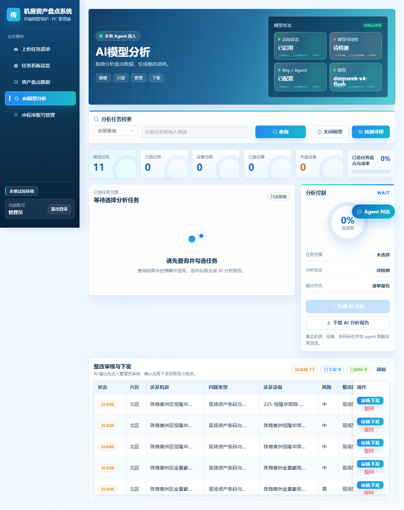

主要功能：

| 功能 | 说明 |
|---|---|
| 模型状态 | 展示启用状态、模型可用性、Key/Agent 配置、实际模型名称 |
| 检测可用 | 检查本地 Agent 和 DeepSeek 模型是否可用，结果以提示形式反馈 |
| 开启/关闭模型 | 管理员可控制 AI 模型分析功能是否启用 |
| 分析任务检索 | 支持按全部、机房、任务、片区、领取人、现场状态筛选任务 |
| 生成 AI 分析 | 选中任务后生成 AI 分析结果和整改草稿 |
| 下载 AI 分析报告 | 下载当前或最新 AI 分析报告，报告不直接铺满页面展示 |
| 整改审核与下发 | 管理员审核 AI 建议后，可选择现场人员并下发整改任务 |

AI 数据安全说明：

- 后端把盘点数据传给本地 Agent。
- 本地 Agent 对上下文做白名单、截断和注入清洗。
- 发送到 DeepSeek 云端前会做数据脱敏。
- 模型只给出建议，不直接写库、不直接下发任务。
- 涉及整改下发和闭环状态变化，必须由管理员审核确认。

### 4.5 全局 Agent 对话

用途：管理员可在任意 PC 页面打开本地 Agent 对话，询问模型配置、操作流程、盘点规则和已选任务上下文。

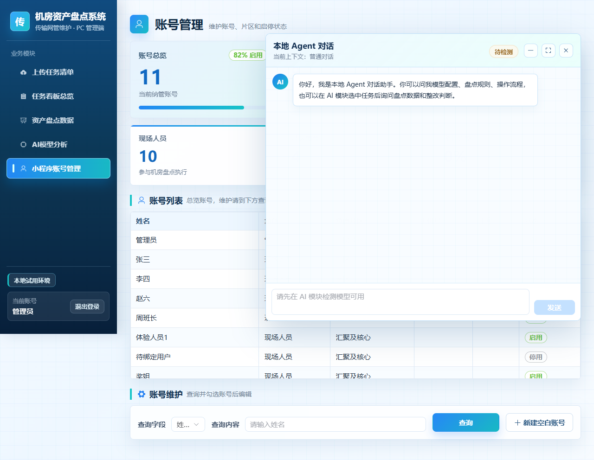

主要功能：

| 功能 | 说明 |
|---|---|
| 悬浮入口 | 页面右下角 `Agent 对话` 按钮 |
| 对话弹窗 | 支持一问一答式聊天 |
| 缩小/放大/关闭 | 可最小化、全屏放大或关闭窗口 |
| 模型状态约束 | 模型未检测可用时，对话输入不可用 |
| 上下文联动 | 在 AI 模块选中任务后，对话可携带选中任务上下文 |

### 4.6 小程序账号管理

用途：维护现场人员账号、片区、联系方式和启停状态。

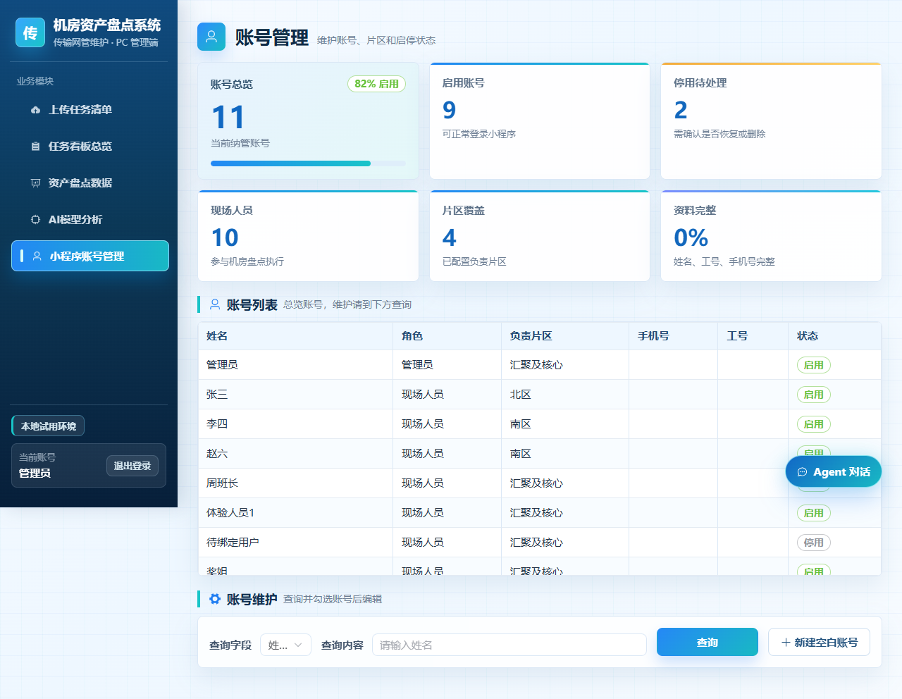

主要功能：

| 功能 | 说明 |
|---|---|
| 账号总览 | 展示账号总数、现场人员数量、启用状态等概览 |
| 账号列表 | 在同一列表查看和维护姓名、角色、片区、手机号、启停状态 |
| 查询账号 | 在列表上方按姓名、登录编码、角色、片区等条件筛选 |
| 新建空白账号 | 点击“账号列表”标题旁的蓝色按钮，新建账号 |
| 编辑账号 | 点击对应行的“编辑”，补充姓名、手机号、片区、角色等 |
| 启用/停用、删除 | 直接操作对应行；删除需确认，历史任务引用保留 |

姓名和手机号建议由现场人员首次登录小程序时自行填写和授权；管理员也可以在后台补充维护。

## 5. 微信小程序功能

以下小程序截图为根据当前小程序页面结构生成的使用示意图，用于系统使用文档说明。正式验收时可使用微信开发者工具或真机替换同名图片。

### 5.1 登录


功能说明：

- 支持微信登录。
- 开发调试模式下可使用测试账号。
- 登录成功后进入工作台。

### 5.2 工作台与资料补充

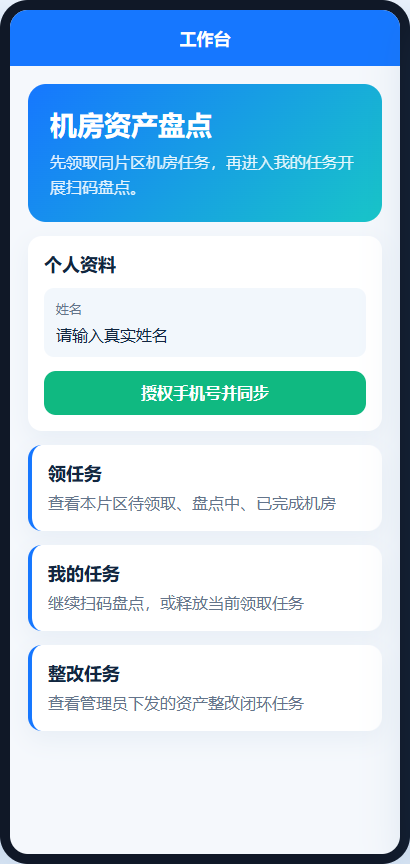

功能说明：

- 首次登录建议填写真实姓名并授权手机号。
- 可进入领任务、我的任务、整改任务。
- 现场人员只能处理所属片区任务。

### 5.3 任务池

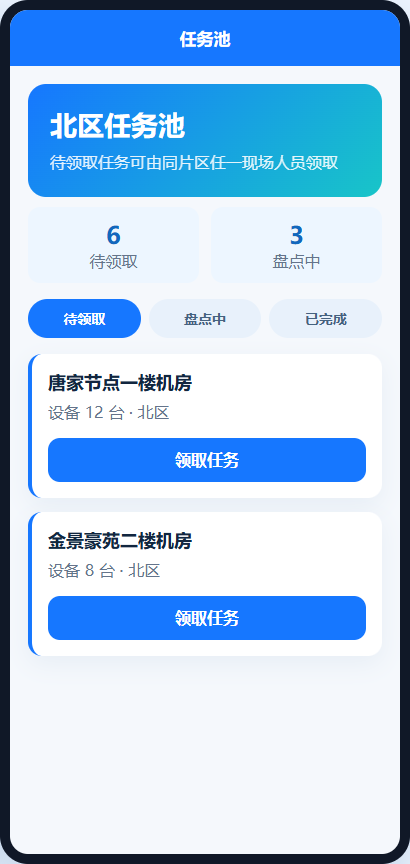

功能说明：

- 查看本片区待领取、盘点中、已完成任务。
- 领取待盘点机房任务。
- 领取成功后进入我的任务继续操作。

### 5.4 我的任务

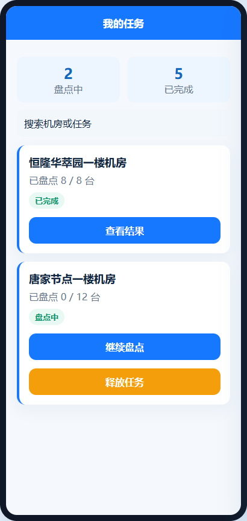

功能说明：

- 查看本人已领取的盘点任务。
- 对盘点中任务继续扫码。
- 对允许释放的任务，可释放回任务池。
- 已完成任务可查看结果。

### 5.5 设备扫码盘点

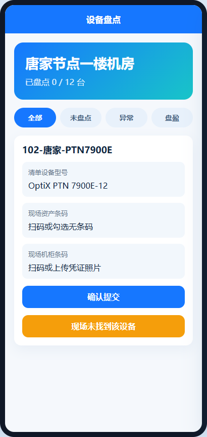

功能说明：

| 功能 | 说明 |
|---|---|
| 设备类别 | 网元名称前显示清单中的设备类别，类别为空时不显示 |
| 展示顺序 | 未盘设备和未提交的编辑草稿优先显示，提交成功的设备自动下沉；同一状态内保留清单原顺序，搜索和筛选沿用此规则 |
| 资产条码扫码 | 扫描现场资产条码并提交 |
| 机柜条码扫码 | 扫描设备所在机柜条码 |
| 无条码处理 | 勾选无资产条码或无机柜条码 |
| 机柜盘点 | 在独立的机柜盘点入口登记传输综合柜、ODF、IODF |
| 盘亏处理 | 现场未找到设备时标记盘亏 |
| 盘盈登记 | 现场发现清单外设备时登记盘盈 |
| 盘盈修正与删除 | 盘点中展开已登记的盘盈设备，点击“修正本次录入”修改名称及采集数据，保存覆盖原记录；误录可点击“删除盘盈”，确认后移除。已完成任务只读，三方比对仅选择已完成机房 |
| 草稿保存 | 本地保存扫码草稿，减少误退出造成的数据丢失 |

### 5.6 整改任务

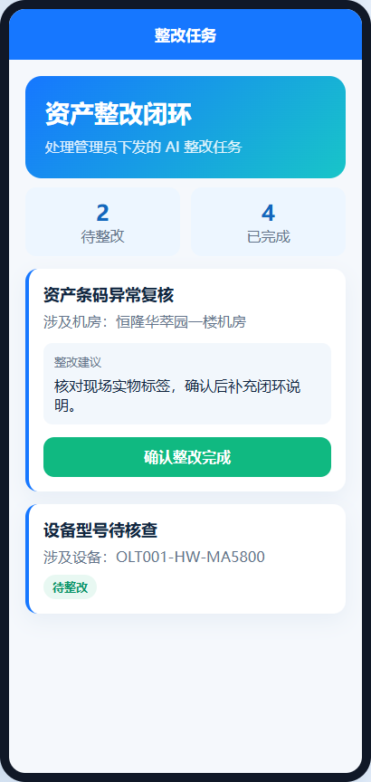

功能说明：

- 接收管理员从 AI 分析模块审核下发的整改任务。
- 查看问题类型、涉及机房、涉及设备和整改建议。
- 现场处理完成后提交闭环说明。

## 6. 常见业务流程

### 6.1 新一轮机房盘点

```text
1. 管理员下载 Excel 模板
2. 管理员整理机房资产清单
3. PC 后台上传并预检清单
4. 预检无误后导入生成待领取任务
5. 现场人员在小程序按片区领取任务
6. 现场人员扫码盘点并提交现场数据
7. 管理员在任务看板查看进度
8. 管理员在资产盘点数据模块查询并导出原始盘点数据
```

### 6.2 AI 分析与整改闭环

```text
1. 启动本地 Agent、后端、PC 后台
2. 管理员进入 AI 模型分析
3. 点击检测可用，确认模型和 Agent 正常
4. 查询并选择需要分析的任务
5. 生成 AI 分析报告
6. 下载 AI 分析报告留档
7. 管理员审核 AI 生成的整改草稿
8. 确认无误后选择现场人员并下发
9. 现场人员在小程序整改任务中处理
10. 现场提交完成后形成闭环状态
```

## 7. AI Agent 管控说明

### 7.1 Prompt 与规则

| 类型 | 路径 | 作用 |
|---|---|---|
| 系统 Prompt | `local_agent/prompts/inventory_analysis.system.md` | 定义 Agent 身份、边界、输出格式 |
| 用户 Prompt | `local_agent/prompts/inventory_analysis.user.md` | 定义本次盘点分析目标和输入格式 |
| 本地确定性规则 | `local_agent/rules.py` | 执行固定规则分析 |
| Prompt 装配 | `local_agent/prompt_loader.py` | 拼装 Prompt |
| Agent 服务入口 | `local_agent/app.py` | 提供 `/analyze`、`/chat`、`/tools`、`/health` |

### 7.2 受控工具注册表

工具统一在 `local_agent/tools/registry.py` 注册，分为两类：

| 类型 | 说明 |
|---|---|
| `read_only` | 只读工具，可用于预检、统计、规则分析 |
| `approval_required` | 涉及上传、导出、下发、整改、闭环，必须经过管理员确认 |

当前已启用的核心只读能力包括：规则分析、清单预检、已完成机房分析。自动上传、自动下发、周报导出、整改闭环跟踪等写动作已登记为受控能力，但默认不允许模型直接执行。

### 7.3 上下文管控

上下文统一经过 `local_agent/context_policy.py` 处理：

- 仅允许白名单字段进入模型上下文。
- 限制发送行数和单字段长度。
- 清理现场备注中的可疑指令注入内容。
- 生成 `context_meta`，记录策略版本、发送行数、截断数量、字段移除数量、payload hash。
- AI 分析结果和上下文摘要保存在数据库中，便于后续审计。

## 8. 运维与安全注意事项

| 项目 | 建议 |
|---|---|
| `.env` | 保存密钥和本地配置，不要提交或发送给他人 |
| API Key | 修改 DeepSeek Key 后需重启后端 |
| 后端监听 | 本机试用建议监听 `127.0.0.1`，避免无意暴露到局域网 |
| 本地 Agent | 独立部署或代理到外部时，需要配置 Agent Token 或网关鉴权 |
| 数据脱敏 | 发往云端模型前必须经过本地 Agent 脱敏和上下文管控 |
| 写操作 | AI 只输出建议，上传、下发、闭环必须由管理员确认 |
| 小程序体验版 | 如需真实微信登录，需正确配置 AppSecret 和外网访问地址 |

## 9. 进一步待开发功能

| 优先级 | 功能 | 说明 |
|---|---|---|
| 高 | 周期性自动分析 | 定时分析已完成盘点的机房，生成待审核整改建议 |
| 高 | 周报自动导出 | 按周导出资产盘点报告，支持管理员确认后下载或归档 |
| 高 | Agent 工具审批台 | 将 `approval_required` 工具做成后台审批流，清晰记录谁确认、何时执行、执行结果 |
| 中 | 小程序整改凭证增强 | 整改任务支持补充照片、备注、复核意见 |
| 中 | AI 分析规则可视化配置 | 管理员可在后台维护 Prompt、规则阈值和风险等级 |
| 中 | 操作审计台 | 集中查看登录、导入、作废、AI 分析、整改下发等审计日志 |
| 中 | 数据备份与恢复 | 提供一键备份数据库和导出文件 |
| 低 | 正式验收截图替换 | 使用微信开发者工具或真机截图替换当前小程序示意图 |
| 低 | 多环境配置面板 | 区分本地试用、体验版、正式环境配置 |

## 10. 附录：常用地址与脚本

| 名称 | 地址/脚本 |
|---|---|
| PC 后台 | `http://127.0.0.1:5173` |
| 后端接口 | `http://127.0.0.1:8000/api` |
| 后端接口文档 | `http://127.0.0.1:8000/docs` |
| 本地 Agent 健康检查 | `http://127.0.0.1:9000/health` |
| 启动后端 | `scripts/windows/start_backend.bat` |
| 启动 PC 后台 | `scripts/windows/start_admin_vue.bat` |
| 启动本地 Agent | `scripts/windows/start_local_agent.bat` |
| 配置 AI Key | `scripts/windows/configure_ai_env.bat` |
| 启用本地 Agent | `scripts/windows/enable_local_agent.bat` |
| 切换小程序模式 | `scripts/windows/switch_miniprogram_mode.bat` |
| 外网隧道后端启动 | `scripts/windows/start_backend_tunnel.ps1` |

## 11. 2026-10-15 流程调整

- 每次清单导入建立独立批次；同一机房的不同轮次分别记录设备、机柜及核对结果。任务看板、资产数据和 AI 任务检索支持按导入批次查询。
- 现场处理全部清单设备后，可继续补录传输综合柜、ODF、IODF 和清单外设备。点击“确认完成本次盘点”才完成并锁定任务。
- 已完成任务不退回重盘。录入错误由管理员在“资产盘点数据 → 修正现场反馈”处理，保存修正原因、版本和原始值。
- 严重问题在资产数据行点击“转整改”，填写问题类型、人工确认依据、整改要求、风险和优先级。随后在“整改闭环台账”选择同片区现场人员下发。
- 人工整改不依赖 AI；现场提交后进入待验收状态，管理员验收后才闭环。已关联规则或人工整改闭环的记录不能直接改写。
- 数据下载改为标准 `.xlsx`，按当前有效结果和本轮机柜数据生成。历史任务保留；缺乏原导入批次信息的旧任务标为 `legacy-任务ID`，不猜测历史批次归属。
- 后端重启会自动执行增量升级，并沿用启动备份机制；开启 `--reload` 的运行服务会随保存代码自动重启。本次已在副本验证升级，并核查热重载产生的真实库升级及备份。


## 三方比对与整改闭环（2026-10-15 更新）

任务清单包含设备类别及必填地点编码。资产信息表需包含条码列、资源名称、地点编码、规格型号。三方比对按机房名称或领取人查询，在弹窗中勾选已完成机房，点击“确定并比对”。每个机房仅显示最近一次已完成盘点，未完成任务不进入正式比对；不同日期导入的机房可一并选择，各自使用对应盘点记录。设备先限定机房地点编码，再按网元／资源名称关联综资、现场和资产，条码、地点和设备机柜位按规则核对，型号由管理员判断。ODF／IODF 机架单独核对。

确认实际问题后建单，在整改闭环台账审核现场/管理员/双方责任。资产、综资先在原系统修改再上传，综资通过比对页“更新综资基线”更新，不重新生成盘点任务。现场只处理本单设备，已完成机房仍锁定。双方提交后进入待验收，后端重新检查最新三方数据；一致且人工型号判断有效后才允许闭环，不通过则继续整改。

综资基线更新后，第一步立即使用新基线重新核对原现场反馈；原始扫描、盘点批次和历次基线仍保留。导出的 Excel 分为“综资与现场”“三方结果”两张表。

详细规则及验证结果见《三方比对与整改闭环规则及逻辑检查-2026-10-15.md》。
